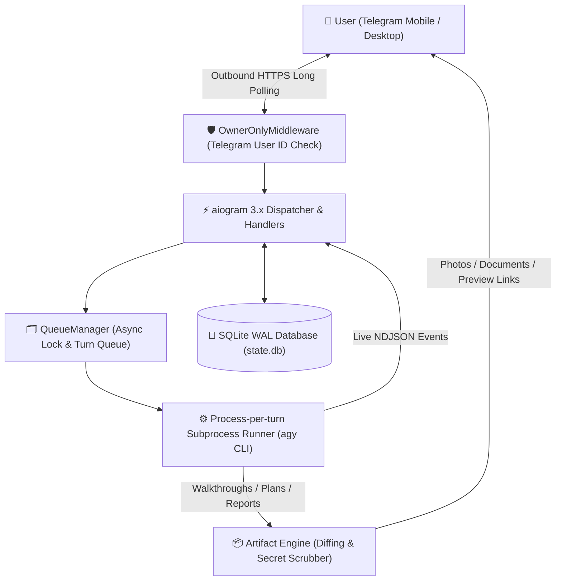

# agmux — Remote Antigravity Telegram Agent

[](https://www.python.org/)
[](https://docs.aiogram.dev/)
[](https://www.sqlite.org/)
[](LICENSE)

**agmux** (Antigravity Multiplexer) is a pragmatic, resilient, single-user Telegram interface for Google Antigravity (`agy`). It gives you full remote access to your server's Antigravity AI coding agent directly through Telegram—with **zero open inbound ports**, no webhooks, no Celery, no Redis, and no fragile persistent PTY processes.

---

## 🎯 Architecture & Design Philosophy

Most remote agent implementations suffer from over-engineering: reverse proxies, complex websocket listeners, persistent pseudo-terminals that deadlock, and heavy databases. `agmux` is deliberately built on lean, battle-tested primitives:

| Concern | Fragile / Complex Approach | The `agmux` Pragmatic Design |
| :--- | :--- | :--- |
| **Telegram Transport** | Nginx reverse proxy + SSL certificates + FastAPI webhooks | **`aiogram 3.x` Long Polling**: Outbound-only HTTPS; zero exposed inbound firewall ports. |
| **CLI Execution** | Fragile persistent PTY shells kept alive across network turns | **Process-per-turn execution** (`asyncio.create_subprocess_exec`) in headless JSON stream mode (`--output-format stream-json`). |
| **Approval Workflow** | Attempting to pipe interactive `[y/N]` stdin prompts | **Two-Stage State Machine (`PLAN` → `EXECUTE`)**: Starts in read-only investigation mode; code mutations require 1-tap Telegram approval. |
| **Turn Activity Log** | Overwriting a single status line or silent execution | **Persistent Command History**: Appends all tool/command executions into a permanent chat message. |
| **Artifact Delivery** | Reverse-engineering internal IPC sockets | **Filesystem Snapshot Diffing**: Auto-detects newly written walkthroughs, plans, and diagrams in outbox and native brain directories with secret scrubbing. |
| **Concurrency & Queue** | Redis + Celery worker queues | **Per-session `asyncio.Lock` + in-memory queue** with `/btw` out-of-band context notes. |
| **State Persistence** | Heavy PostgreSQL + SQLAlchemy + Alembic migrations | **Single SQLite file (`state.db`)** with Write-Ahead Logging (`WAL` mode) via `aiosqlite`. |

---

## 🏗️ System Topology



---

## ✨ Key Features

- 🛡️ **Human-in-the-Loop Approval Gate:** Sessions start in read-only `PLAN` mode (`--mode plan`). Mutating code requires tapping **[✅ Approve & Execute Plan]**, which launches an authorized turn (`--mode accept-edits`).
- 📋 **Persistent Command History Streaming:** Watch commands execute in real-time (`git status`, `read_file`, `npm test`). The completed command log is preserved permanently in chat.
- 📬 **Structured 3-Stage Delivery:**
  1. *Message 1:* Live Command History log (kept in chat).
  2. *Message 2:* Structured agent response / solution.
  3. *Message 3+:* Attached artifacts (`.md`, `.png`, `.html`, `.patch`).
- ⏱️ **Turn Queuing & `/btw` Notes:** Send messages anytime. If a task is running, new prompts queue automatically with cancel controls. Use `/btw <note>` to inject out-of-band context without interrupting the task.
- 🔐 **First-Turn Auto-Claim:** Simply start the bot; the first user account to send `/start` automatically binds as the sole owner and locks out anyone else.
- 🧼 **Automated Secret Guardrail:** Automatically scans candidate files before upload, blocking sensitive extensions (`.env*`, `*.pem`, `*.key`) and redacting API keys and connection strings.
- 🎛️ **Dual UI (Touch-Friendly):** Full control via a persistent keyboard menu at the bottom of the screen, an interactive inline dashboard (`/menu`), and slash commands.
- 🧠 **Native Brain Explorer (`/brain`):** Seamlessly inspect or attach to conversations started in the desktop Antigravity IDE (`~/.gemini/antigravity/brain/`).

---

## 📁 Repository Structure

```text
agmux/
├── .env.example            # Environment configuration template
├── projects.json           # Allowlist mapping project slugs to repo directories
├── requirements.txt        # Minimal async dependencies
├── main.py                 # Bot entrypoint, command handlers, and polling loop
├── db.py                   # SQLite schema and async query interface (WAL mode)
├── runner.py               # agy CLI subprocess execution and NDJSON stream parser
├── artifacts.py            # Pre/post snapshot diffing and secret scrubbing
├── queue_manager.py        # Per-session async lock and turn queue
├── service/
│   └── agmux.service       # Production systemd unit template
└── tests/                  # Automated pytest suite (23 tests)
```

---

## 🚀 Quickstart

### 1. Prerequisites
- Linux host running Google Antigravity CLI (`agy`) installed and authenticated.
- Python 3.10 or higher.
- A Telegram Bot Token from [@BotFather](https://t.me/BotFather).

### 2. Clone and Setup Environment

```bash
git clone https://github.com/javad-hosseini/agmux.git
cd agmux

python3 -m venv .venv
source .venv/bin/activate
pip install -r requirements.txt
```

### 3. Configure `.env` and `projects.json`

Copy the template configuration:

```bash
cp .env.example .env
chmod 600 .env
```

Edit `.env`:
```ini
# Required: Telegram Bot Token from @BotFather
BOT_TOKEN=123456789:ABCDEF_your_telegram_bot_token

# Leave 0 to auto-claim ownership with your first Telegram message!
ALLOWED_USER_ID=0

# Path to the Antigravity CLI binary
AGY_BIN=/usr/local/bin/agy

# Local data directory for state.db and session artifacts
DATA_DIR=./data

# Path to the projects allowlist
PROJECTS_FILE=./projects.json

# Optional: Web URL prefix for viewing HTML artifacts in browser (e.g., via Nginx or Tailscale)
# ARTIFACTS_BASE_URL=https://agmux.internal.lan/artifacts
```

Edit `projects.json` to map project slugs to absolute repository paths on your server:
```json
{
  "agmux": "/home/user/projects/agmux",
  "web-app": "/home/user/projects/web-app",
  "backend": "/var/www/backend"
}
```

### 4. Run the Test Suite

Verify that your environment and modules are operating correctly:

```bash
pytest -v tests/
```

### 5. Launch the Bot

```bash
python main.py
```

Open Telegram, find your bot, and send:
```text
/start
```
> **Auto-Claim Active:** If `ALLOWED_USER_ID=0`, `agmux` binds to your Telegram account on the very first message, writes your numeric ID into `.env`, and locks down access permanently.

---

## 🎮 Telegram Controls & Commands

| Button | Slash Command | Description |
| :--- | :--- | :--- |
| `📂 Projects` | `/projects` | View allowlisted projects with 1-tap switch buttons |
| — | `/project <slug>` | Switch active repository directly |
| `🆕 New Session` | `/new [title]` | Start a fresh session (defaults to read-only `PLAN` mode) |
| `💬 Sessions` | `/sessions` | List recent sessions with tap-to-switch buttons |
| — | `/resume <id>` | Switch to a session by ID |
| `⚙️ Toggle Mode` | `/mode [plan\|execute]` | 1-tap toggle between `PLAN` (read-only) and `EXECUTE` (write) |
| `[Approve]` | *(Inline Button)* | Approves plan and triggers code changes on current session |
| `🧠 Brain` | `/brain` | Browse 5 most recent native desktop Antigravity sessions |
| `📝 Note (/btw)`| `/btw <note>` | Inject context into active or queued task without interrupting |
| `🛑 Cancel` | `/cancel` | Terminate running CLI turn (SIGTERM) and clear queue |
| `📊 Status` | `/status` | View active project, session mode, process state, and queue depth |
| `📖 Help` | `/help` or `/menu` | Open the command guide or interactive dashboard |

---

## ⚙️ Production Systemd Deployment

To run `agmux` as an automated, auto-restarting background daemon:

1. Edit `service/agmux.service` to match your local user and repository paths:
   ```ini
   User=your_username
   Group=your_username
   WorkingDirectory=/home/your_username/projects/agmux
   EnvironmentFile=/home/your_username/projects/agmux/.env
   ExecStart=/home/your_username/projects/agmux/.venv/bin/python /home/your_username/projects/agmux/main.py
   ```

2. Copy the unit file and enable the service:
   ```bash
   sudo cp service/agmux.service /etc/systemd/system/
   sudo systemctl daemon-reload
   sudo systemctl enable --now agmux.service
   ```

3. Monitor live service logs:
   ```bash
   sudo journalctl -u agmux.service -f
   ```

---

## 🔒 Security & Privacy

- **Zero Inbound Attack Surface:** Uses long-polling exclusively. No HTTP ports or webhook URLs are opened on your server.
- **Single-User Middleware:** Any message or callback from an unauthorized Telegram user ID is silently dropped before reaching the application layer.
- **Strict Mode Separation:** New sessions default to read-only `PLAN` mode. Antigravity cannot modify source files or execute mutating commands until explicitly approved via Telegram.
- **Automatic Secret Redaction:** Files matching sensitive patterns (`.env*`, `*.pem`, `*.key`, `id_rsa*`, `credentials.json`) are blocked from delivery. Text files are scanned with regexes to scrub API keys, private keys, and database credentials before transmission.

---

## 📄 License

This project is licensed under the MIT License — see the [LICENSE](LICENSE) file for details.
